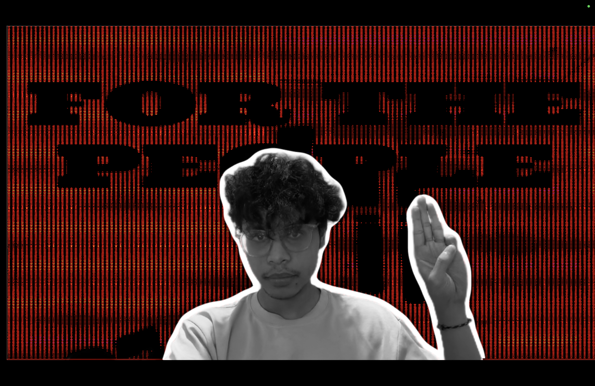
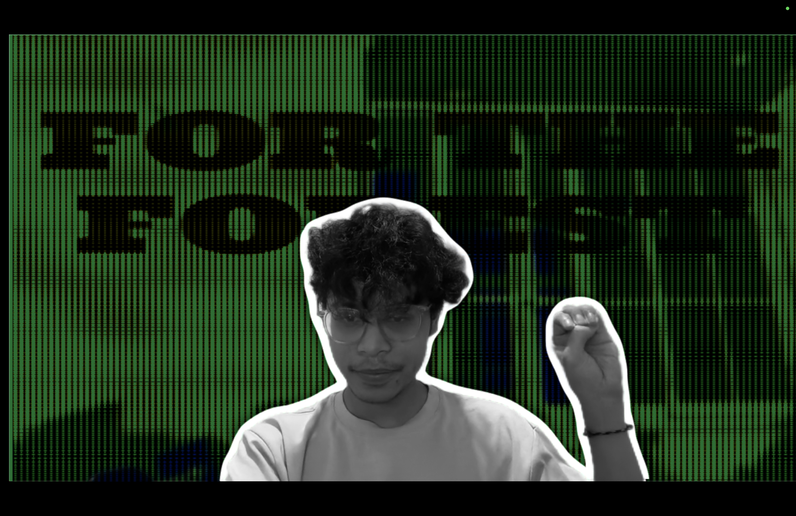

# Tiga Jari Effect
This is the Tiga Jari effect, to raise awareness about the problems currently in Indonesia. Made in TouchDesigner.

## Requirements
- TouchDesigner 2026+ (any license) - [install here](https://derivative.ca/download)
- MediaPipe TouchDesigner Plugin by torinmb - [download here](https://github.com/torinmb/mediapipe-touchdesigner)
- On Windows, NVIDIA RTX GPU
- On Mac, Apple Silicon and VisionBackground TOP Plugin by stosumarte - [download here](https://github.com/stosumarte/VisionBackgroundTOP)

## How to Use
1. Have TouchDesigner ready, then make sure you have [MediaPipe's Plugin](https://github.com/torinmb/mediapipe-touchdesigner) and [VisionBackground's Plugin](https://github.com/stosumarte/VisionBackgroundTOP) if you're on Mac with Apple Silicon. Follow their respective tutorials on how to install.
2. Download tigajari's zip project file, then unzip it.
3. Install the font inside the FONTS folder.
4. Copy the MediaPipe.tox and hand_tracking.tox from MediaPipe's download into the toxes folder.
5. Open the tigajari.toe file.
6. Look (command+F or ctrl+F) for the node bg_remove_MAC or bg_remove_WINDOWS. Both of them should be bypassed. Unbypass the correct one according to your operating system (if you don't have either the NVIDIA RTX GPU or Apple Silicon, leave them both bypassed).
7. Look for the node Output and click on the Open as Separate Window parameter. Hold up the "tiga jari" gesture with your right hand. You can change the background by "pressing" your hand. Press ESC to close the window.

## Notes
The gesture detection only works for the right hand.

I created the project on Mac, so this is untested for Windows users. If anybody is using Windows with NVIDIA RTX GPU, let me know if there are any problems.

If you don't have the NVIDIA RTX GPU or Apple Silicon, the effect should still work, just without the foreground removal.

This is one of my first projects on TouchDesigner, so there's always a chance that things go wrong. If so, you can shoot me a DM on Instagram (@aldotendean) and I'll try to help if I can. Thank you for testing out my work!

## Credits
- MediaPipe TouchDesigner Plugin by torinmb
- VisionBackground TOP Plugin by stosumarte
- Ultra font by Astigmatic
